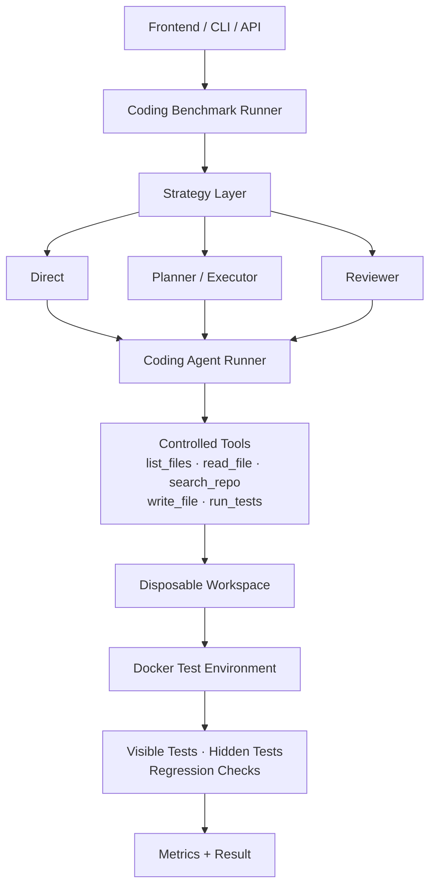

# AgentBench

### Coding-Agent Benchmark for Evaluating Repository-Level Software Agents


AgentBench evaluates coding agents that inspect repositories, edit source files,
run visible tests through controlled tools, and are scored using hidden tests and
regression checks inside isolated Docker environments.

## Features

- Repository inspection and controlled file editing
- Controlled visible-test execution in isolated Docker containers
- Hidden-test evaluation and regression detection
- Direct, Planner/Executor, and Reviewer strategies
- Easy, medium, and hard repository-level tasks
- Gemini, OpenRouter, and OmniRoute provider support
- Success, runtime, tool-use, patch, and failure metrics
- Next.js web dashboard, command-line interface, and FastAPI API

## Architecture



Each strategy receives its own copied repository workspace. The coding agent can
work only through the configured tool surface; final evaluation runs separately
against visible and hidden tests.

## Repository Structure

```text
AgentBench/
├── backend/
│   ├── app/                 FastAPI application, CLI, models, services, strategies
│   ├── benchmarks/          Generic exact-match benchmark definitions
│   ├── coding_benchmarks/   Isolated easy, medium, and hard coding fixtures
│   ├── docker/              Python benchmark image definition
│   ├── scripts/             Real end-to-end validation entry point
│   └── tests/               Backend unit and integration tests
├── frontend/
│   ├── app/                 Next.js routes and pages
│   ├── components/          Dashboard UI components
│   └── lib/                 API client and shared frontend types
├── results/                 Generated generic benchmark results
├── .gitignore
└── README.md
```

## Agent Strategies

- **Direct** — the agent solves the task directly with the controlled repository
  tools.
- **Planner/Executor** — a planner produces a structured plan, then an executor
  performs the planned work.
- **Reviewer** — an initial solution is reviewed and may be revised before final
  evaluation.

## Coding Benchmark Tasks

The current suite contains six Python repository fixtures, with two tasks at
each difficulty level:

- **Easy** — focused fixes or implementations with a small local change.
- **Medium** — changes spanning multiple modules, with edge cases beyond the
  basic visible coverage.
- **Hard** — broader repository problems involving several interacting modules
  and regression-sensitive behavior.

Every fixture begins in an intentionally failing state and includes source code,
visible tests, private evaluation tests, and task metadata. Hidden test content,
commands, and expected outputs are not exposed to the agent.

## Controlled Tools

Coding agents receive only the tools allowed by the selected task:

- `list_files` lists accessible repository files.
- `read_file` reads an accessible file by repository-relative path.
- `search_repo` searches accessible repository text.
- `write_file` creates or updates a repository file within the workspace.
- `run_tests` executes the task's configured visible-test command.

The model cannot supply an arbitrary shell command to `run_tests`. Visible tests
may be inspected but are read-only, while hidden tests are excluded from file
listing, reading, searching, and writing.

## Security and Isolation

AgentBench applies these concrete controls to coding benchmark execution:

- Docker networking is disabled with `--network none`.
- Containers receive CPU and memory limits.
- Containers are not privileged and the Docker socket is not mounted.
- File access is confined to resolved paths inside the copied repository.
- Processes are invoked without `shell=True`.
- Hidden tests are inaccessible through coding-agent tools.
- Visible benchmark tests are protected from modification.
- Provider API keys remain in backend configuration and are never sent to the
  browser.

These controls reduce the execution surface; they are not a substitute for
reviewing the host's Docker and provider configuration.

## Metrics

Each coding strategy result records:

- task success
- visible-test and hidden-test results
- regression status
- tool-call count and runtime
- files changed
- lines added and removed
- patch size
- failure category

Token and cost fields are supported by the result schema but depend on provider usage metadata.

## Setup

### Backend

From the repository root:

```powershell
cd backend
python -m venv venv
venv\Scripts\activate
pip install -r requirements.txt
copy .env.example .env
uvicorn app.main:app --reload
```

The API is served at `http://127.0.0.1:8000`; interactive documentation is at
`http://127.0.0.1:8000/docs`.

### Frontend

In a second terminal:

```powershell
cd frontend
npm install
copy .env.example .env.local
npm run dev
```

Open `http://localhost:3000`. The frontend uses:

```dotenv
NEXT_PUBLIC_API_BASE_URL=http://127.0.0.1:8000
```

### Environment Variables

Copy `backend/.env.example` to `backend/.env` and configure only the providers
you intend to use:

- Gemini: `GEMINI_API_KEY`, `GEMINI_MODEL`
- OpenRouter: `OPENROUTER_API_KEY`, `OPENROUTER_BASE_URL`
- OmniRoute: `OMNIROUTE_BASE_URL`, `OMNIROUTE_API_KEY`,
  `OMNIROUTE_TIMEOUT_SECONDS`

Keep real credentials out of version control.

### Docker

Docker Desktop or Docker Engine must be running for coding benchmarks. Build the
isolated Python image from `backend/`:

```powershell
docker build -f docker/agentbench-python.Dockerfile -t agentbench-python .
```

## Usage

Run these commands from `backend/` after configuring the selected provider.

### Generic Benchmark

```powershell
python -m app.cli run --provider openrouter --name "OpenRouter Agent" --model "openai/gpt-4o-mini"
```

### Coding Benchmark

```powershell
python -m app.cli coding-run --task easy-arithmetic-helper --provider openrouter --model "openai/gpt-4o-mini" --strategy direct
```

Repeat `--strategy` to compare strategies in one run, or omit it to run all
three strategies.

### Real End-to-End Validation

```powershell
python scripts/validate_coding_benchmark.py --task easy-arithmetic-helper --provider openrouter --model "openai/gpt-4o-mini" --strategy direct
```

The validator confirms the baseline failure, runs the production agent pipeline,
evaluates the changed copy, checks for regressions, and verifies that the source
fixture remains byte-for-byte unchanged. Use `--keep-workspace` when a local copy
is needed for debugging.

### Web Dashboard

1. Start the FastAPI backend.
2. Start the Next.js frontend.
3. Open `http://localhost:3000/run`.
4. Select a task.
5. Select a provider and model.
6. Select a strategy.
7. Run the benchmark.
8. Inspect the returned test, runtime, tool-use, patch, and failure metrics.

## FastAPI API

The backend exposes endpoints for generic task listing and execution, stored
result retrieval and comparison, coding-task discovery, and coding benchmark
execution. Use the generated OpenAPI documentation at `/docs` for current request
and response schemas. Provider credentials are read from backend environment
configuration and are not part of API responses.

## Proven Validation Example

A real end-to-end validation completed successfully with the following setup and
result:

```text
Task:                easy-arithmetic-helper
Provider:            OpenRouter
Model:               openai/gpt-4o-mini
Strategy:            Direct

Agent success:       True
Visible tests:       passed
Hidden tests:        passed
Regression detected: False
Tool calls:          5
Files changed:       1
Lines added:         1
Lines removed:       1
Patch size:          2
Failure category:    none
Validation success:  True
```

No hidden-test details or provider credentials are included in validation
output.

## Testing

Run the backend suite from `backend/`:

```powershell
pytest
```

Current validated result: **265 passed, 1 skipped**.

Run a frontend production build from `frontend/`:

```powershell
npm install
npm run build
```

## Project Highlights

- Built a coding-agent benchmark with controlled repository tools and isolated
  Docker execution.
- Implemented Direct, Planner/Executor, and Reviewer strategies across easy,
  medium, and hard software tasks.
- Evaluated agents with visible and hidden tests, regression checks, runtime,
  tool usage, patch metrics, and failure categories.
