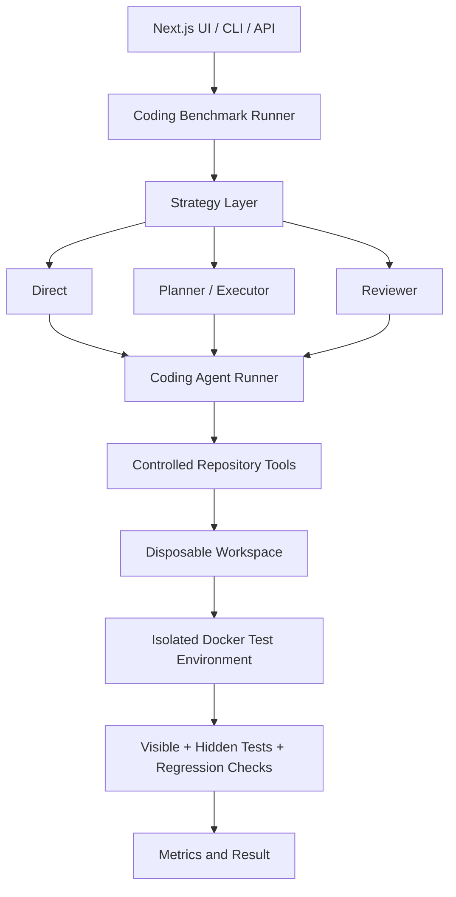

<div align="center">


**Evaluate how coding agents inspect repositories, edit code, use tools, and solve software tasks.**


</div>

## Overview

AgentBench is a full-stack benchmark for repository-level coding agents. An agent receives a software task and a controlled set of repository tools, works inside a disposable copy of the target project, and is evaluated with visible tests, hidden tests, and regression checks in an isolated Docker environment.

The framework supports three agent strategies—Direct, Planner/Executor, and Reviewer—and can run models through Gemini, OpenRouter, or OmniRoute. Results are exposed through a FastAPI service, command-line interface, and Next.js dashboard.

## Key Features

- Controlled repository inspection, search, editing, and visible-test execution.
- Separate hidden-test evaluation that is not exposed through agent tools.
- Docker execution with networking disabled and CPU/memory limits.
- Direct, Planner/Executor, and Reviewer agent strategies.
- Six repository fixtures across easy, medium, and hard difficulty levels.
- Success, runtime, tool-use, patch, regression, and failure-category metrics.
- Generic exact-match benchmarks alongside repository-level coding benchmarks.
- FastAPI API, Python CLI, and browser-based Next.js dashboard.

## Architecture



Each strategy receives its own repository copy. The agent can interact only through the tools allowed by the task; final evaluation runs separately from the visible-test workflow.

## Agent Strategies

- **Direct** — solves the task through the available repository tools without a separate planning stage.
- **Planner/Executor** — produces a structured plan before carrying out the implementation.
- **Reviewer** — reviews an initial solution and may revise it before final evaluation.

## Controlled Tool Surface

| Tool | Purpose |
|---|---|
| `list_files` | List accessible repository files |
| `read_file` | Read an accessible repository-relative file |
| `search_repo` | Search accessible repository text |
| `write_file` | Create or update a file inside the disposable workspace |
| `run_tests` | Run the task's configured visible-test command |

Agents cannot supply arbitrary shell commands to `run_tests`. Visible tests are readable but protected from modification, while hidden tests are excluded from listing, reading, searching, and writing.

## Benchmark Suite

The repository contains six Python coding fixtures:

- **Easy:** arithmetic helper and string utility.
- **Medium:** account validation and configuration cache.
- **Hard:** dependency resolver and feature flags.

Each fixture contains intentionally incomplete or failing source code, visible tests, hidden evaluation tests, and task metadata. The benchmark records whether the task succeeds, whether regressions occur, and how much work the agent performs.

## Metrics

Each strategy result can report:

- visible- and hidden-test outcomes;
- regression status and overall task success;
- runtime and tool-call count;
- files changed, lines added, and lines removed;
- patch size and failure category.

Token and cost fields are supported by the result schema when the selected provider returns usable usage metadata.

## Project Structure

```text
AgentBench/
├── backend/
│   ├── app/
│   │   ├── api/                 # FastAPI routes
│   │   ├── models/              # Tasks, plans, results, and metrics
│   │   ├── services/            # Runners, providers, tools, and evaluation
│   │   └── strategies/          # Direct, Planner/Executor, Reviewer
│   ├── benchmarks/              # Generic exact-match tasks
│   ├── coding_benchmarks/       # Easy, medium, and hard fixtures
│   ├── docker/                  # Isolated Python benchmark image
│   ├── scripts/                 # End-to-end validator
│   └── tests/                   # Backend tests
├── frontend/
│   ├── app/                     # Next.js routes
│   ├── components/              # Benchmark dashboard components
│   └── lib/                     # API client and shared types
└── results/                     # Generated benchmark results
```

## Installation

### Prerequisites

- Python 3.11
- Node.js and npm
- Docker Desktop or Docker Engine
- Credentials for at least one supported model provider

### Backend

```powershell
git clone https://github.com/FarisDosani/AgentBench.git
cd AgentBench\backend

py -3.11 -m venv venv
.\venv\Scripts\Activate.ps1
pip install -r requirements.txt
Copy-Item .env.example .env
uvicorn app.main:app --reload
```

The API runs at `http://127.0.0.1:8000`; interactive OpenAPI documentation is available at `http://127.0.0.1:8000/docs`.

Configure only the providers you intend to use in `backend/.env`:

```dotenv
GEMINI_API_KEY=
GEMINI_MODEL=gemini-3.5-flash

OPENROUTER_BASE_URL=https://openrouter.ai/api/v1
OPENROUTER_API_KEY=

OMNIROUTE_BASE_URL=http://localhost:20128/v1
OMNIROUTE_API_KEY=
OMNIROUTE_TIMEOUT_SECONDS=60
```

Keep real credentials outside version control.

### Frontend

In a second terminal:

```powershell
cd AgentBench\frontend
npm install
Copy-Item .env.example .env.local
npm run dev
```

Open `http://localhost:3000`. By default, the frontend expects the API at `http://127.0.0.1:8000` through `NEXT_PUBLIC_API_BASE_URL`.

### Docker Image

From `backend/`:

```powershell
docker build -f docker/agentbench-python.Dockerfile -t agentbench-python .
```

Docker must be running before repository-level coding benchmarks are executed.

## Usage

Run commands from `backend/` after configuring a provider.

### Run a Generic Benchmark

```powershell
python -m app.cli run `
  --provider openrouter `
  --name "OpenRouter Agent" `
  --model "openai/gpt-4o-mini"
```

### Run a Coding Benchmark

```powershell
python -m app.cli coding-run `
  --task easy-arithmetic-helper `
  --provider openrouter `
  --model "openai/gpt-4o-mini" `
  --strategy direct
```

Repeat `--strategy` to compare selected strategies, or omit it to run Direct, Planner/Executor, and Reviewer.

### Validate the End-to-End Pipeline

```powershell
python scripts/validate_coding_benchmark.py `
  --task easy-arithmetic-helper `
  --provider openrouter `
  --model "openai/gpt-4o-mini" `
  --strategy direct
```

The validator confirms the baseline failure, runs the production agent workflow, evaluates the modified copy, checks regressions, and verifies that the source fixture remains unchanged. Add `--keep-workspace` to retain the disposable copy for debugging.

### Web Dashboard

1. Start the backend and frontend.
2. Open `http://localhost:3000/run`.
3. Choose a task, provider, model, and strategy.
4. Run the benchmark and inspect test, runtime, tool-use, patch, and failure metrics.

## API

The FastAPI service provides routes for:

- listing and running generic benchmark tasks;
- listing, retrieving, and comparing stored results;
- discovering coding tasks;
- running repository-level coding benchmarks.

Refer to `/docs` for the current request and response schemas. Provider credentials remain in backend configuration and are not returned to the browser.

## Security and Isolation

AgentBench applies the following execution controls:

- Docker networking is disabled with `--network none`.
- Containers receive CPU and memory limits.
- Containers are unprivileged and do not mount the Docker socket.
- Repository paths are resolved within the disposable workspace.
- Processes are invoked without `shell=True`.
- Hidden tests are inaccessible through agent tools.
- Visible tests are protected from modification.
- Provider keys remain on the backend.

These controls reduce the execution surface but do not replace careful review of the host, Docker, and provider configuration.

## Validation and Testing

The repository records a successful end-to-end validation for `easy-arithmetic-helper` using the Direct strategy through OpenRouter: visible and hidden tests passed, no regression was detected, and one source file changed.

Run the backend test suite from `backend/`:

```powershell
pytest
```

The existing documented baseline is **265 passed and 1 skipped**. Build the frontend with:

```powershell
cd ..\frontend
npm install
npm run build
```

---

<div align="center">

Built as a practical framework for inspecting how coding-agent strategies behave under controlled, repeatable evaluation.

<a href="https://github.com/FarisDosani/AgentBench">View repository</a> · <a href="https://github.com/FarisDosani/AgentBench/issues">Report an issue</a>


</div>
